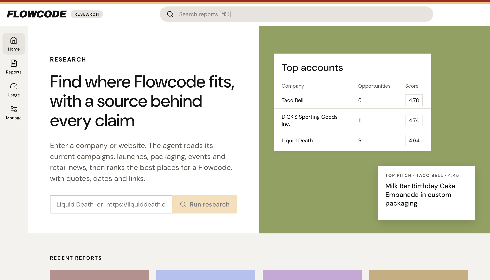
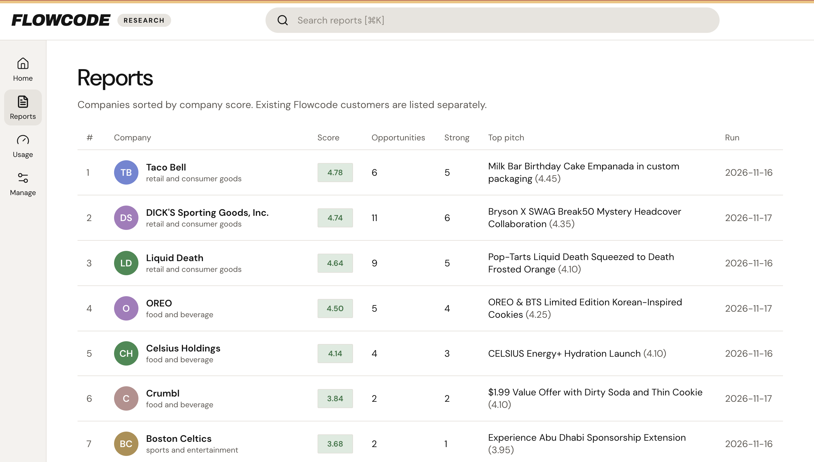
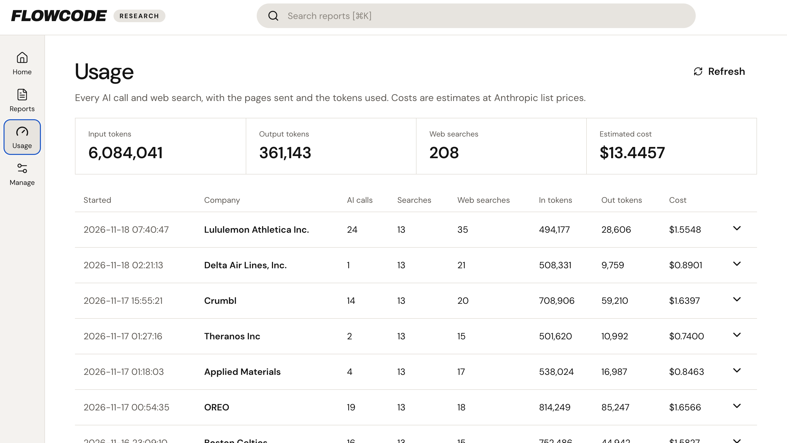
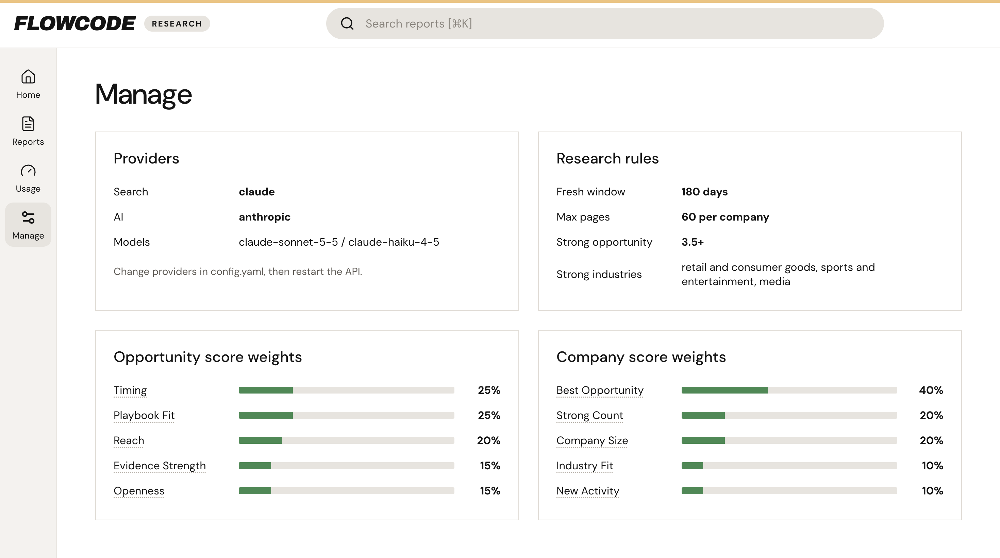
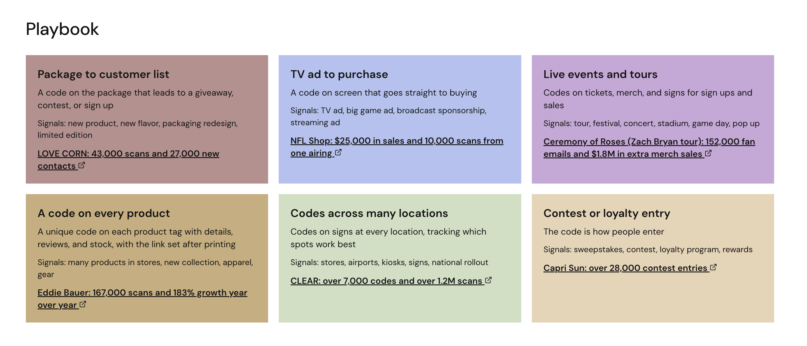

# Flowcode research agent

Give it a company name. It finds what the company is doing right now (launches, ads, packaging, events,
sponsorships, loyalty programs) and returns a ranked list of places Flowcode's QR codes could help.
Every idea comes with the source link, date and an exact quote, so a sales rep can trust it.

## Screenshots

| Home | Reports |
|---|---|
|  |  |
| **Usage** (tokens and cost per run) | **Manage** (providers and scoring weights) |
|  |  |

**Playbook** (the Flowcode use cases each finding is matched to)



## How it works

1. **Find the company**: its official website, industry and brands.
2. **Search**: run 11 searches (campaigns, new ads, TV, sponsorships, packaging, loyalty, press releases, and so on)
   and read the pages found. Old pages are skipped.
3. **Find moments**: the AI picks out specific things happening, like "new empanada in custom packaging,
   nationwide from Oct 15", each backed by a sentence copied from a page.
4. **Match to Flowcode**: each moment is matched to a proven Flowcode use case (for example, a code on packaging
   that signs people up) and gets a suggested pitch.
5. **Check the facts**: the code confirms every quote really appears on its page, and the AI removes anything the
   quotes don't support.
6. **Score**: the AI rates timing, fit, reach, evidence and openness from 1 to 5; the code turns these into a score.
7. **Report**: a ranked report in the web app, downloadable as a PDF.

## Tradeoffs

- **Accuracy over coverage.** Nothing goes in a report without a real quote. Some true facts are lost, for example
  when a site blocks our reader, but every claim can be defended.
- **A fixed list of searches.** Predictable cost and easy to compare companies, but it works much better for
  consumer brands than for B2B companies, where many searches find nothing.
- **The AI judges, the code does the math.** Scores are explainable and the weights are easy to change, but the
  weights are starting guesses, not yet tuned on real sales results.
- **Simple code, no agent framework.** Easy to read and test, but each worker researches one company at a time.

## Running it across thousands of companies

Today one company takes about **6 to 8 minutes** and costs about **$1.50 to $3**. Most of that cost is web search,
because the AI reads every search result even though we only need the links.

- **Cost:** use a search service that just returns links and charges per search, instead of having the AI read the
  results. This cuts most of the cost. Check big accounts often and small ones rarely, with a budget for each.
- **Speed:** run many companies at the same time from a work queue. Each step is saved, so a failed run picks up
  where it stopped.
- **Keeping data fresh:** re-check companies on a schedule and only redo the expensive AI work when new pages
  appear. Events drop out automatically once their end date passes.
- **Checking quality:** track how many claims pass the fact check and how recent the sources are. Re-run a small set
  of companies with known answers after every change, and let sales reps mark each idea as useful or not.

## Making it an always-on agent

1. **Keep a watch list** of customers and prospects, and check important ones more often.
2. **Run it on a schedule**, with extra checks before big moments like the Super Bowl, back to school and the
   holidays, or when a company's newsroom changes.
3. **Only alert on what's new**: when a new strong opportunity appears, send it with the pitch and sources to
   Slack, email or the CRM, and never send the same one twice.
4. **Learn from feedback**: use reps' "useful or not" ratings to tune the scores and how often each account is checked.
5. **Keep it safe and affordable**: the fact check always runs, every run's cost is tracked, and a weekly summary
   shows what was found and what it cost.

## Run it

```bash
python3 -m venv .venv && .venv/bin/pip install -r requirements.txt
cp .env.example .env                                   # add DATABASE_URL and ANTHROPIC_API_KEY
cd web && npm install && npm run build && cd ..
.venv/bin/uvicorn api:app --port 8600                  # open http://localhost:8600
.venv/bin/python -m pytest                             # tests, no network needed
```

It deploys to Render with the included `Dockerfile` and stores its data in Postgres (Supabase).
